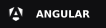
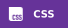
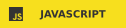
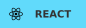
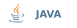

---

<h2>Sobre mim</h2>

Sou um estudante no curso técnico em desenvolvimento de sistemas no <a href="https://www.sp.senai.br/unidade/suicobrasileira/">SENAI Suíço-Brasileira</a>,  onde estudo front-end, back-end, banco de dados e IoT. Atualmente estou focando em desenvolvimento web, aprendendo tecnologias como React e Angular no front-end e Spring Boot no back-end.

<h2>Projetos em destaque</h2>
<ul>
    <li>
        
<a href="https://github.com/GoBrazill/pc-spike-smacss">POC Spike SMACSS</a> - Pesquisa que realizei que envolve o método SMACSS para a organização do css.

    </li>
    <li>
        
<a href="https://github.com/professor-correa/campus-datacenter-explorer">Datacenter SENAI</a> - Projeto criado em turma que explica os protocolos dos servidores no senai suiço.

    </li>
    <li>
        
<a href="https://github.com/GoBrazill/project-neofi">Projeto Neofi</a> - Site fictício sobre ser o futuro da conexão, segurança e escalabilidade em tecnologia blockchain.

    </li>
    </li>
    <li>
        
<a href="https://github.com/GoBrazill/project-nexcent">Projeto Nexcent</a> - Nexcent é um site que desenvolvi em conjunto com meus professores, a partir de um template no Figma, com o objetivo de praticar e consolidar meus conhecimentos em HTML e CSS.

    </li>
    <li>
        
<a href="https://github.com/GoBrazill/project-nexcent">Angular Homes App</a> - Projeto que construí seguindo um tutorial do canal oficial do Angular no YouTube.

    </li>
</ul>

<h2>Estudando no momento</h2>

<h2>Ferramentas que utilizo</h2>

<h3>Front-end</h3>

<h3>Design</h3>

<h3>Back-end</h3>

<h3>Banco de dados</h3>

<h3>Versionamento</h3>

<h2>Contato</h2>
<ul>
    <li>
        
        <a href="https://www.linkedin.com/in/vinicius-a-silva" target="_blank">Vinicius Silva</a>
    </li>
    <li>
        
        <a href="mailto:vinicius.daraujos26@gmail.com">vinicius.daraujos26@gmail.com</a>
    </li>
</ul>

